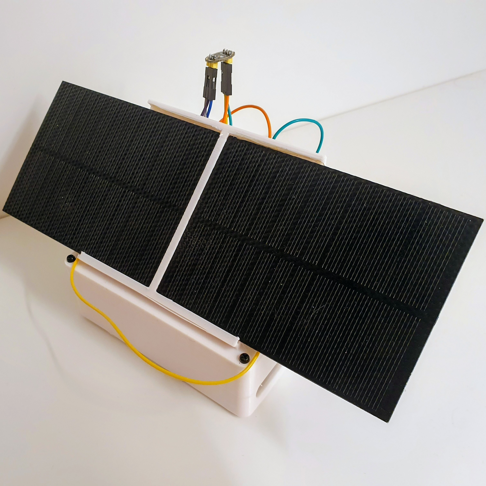
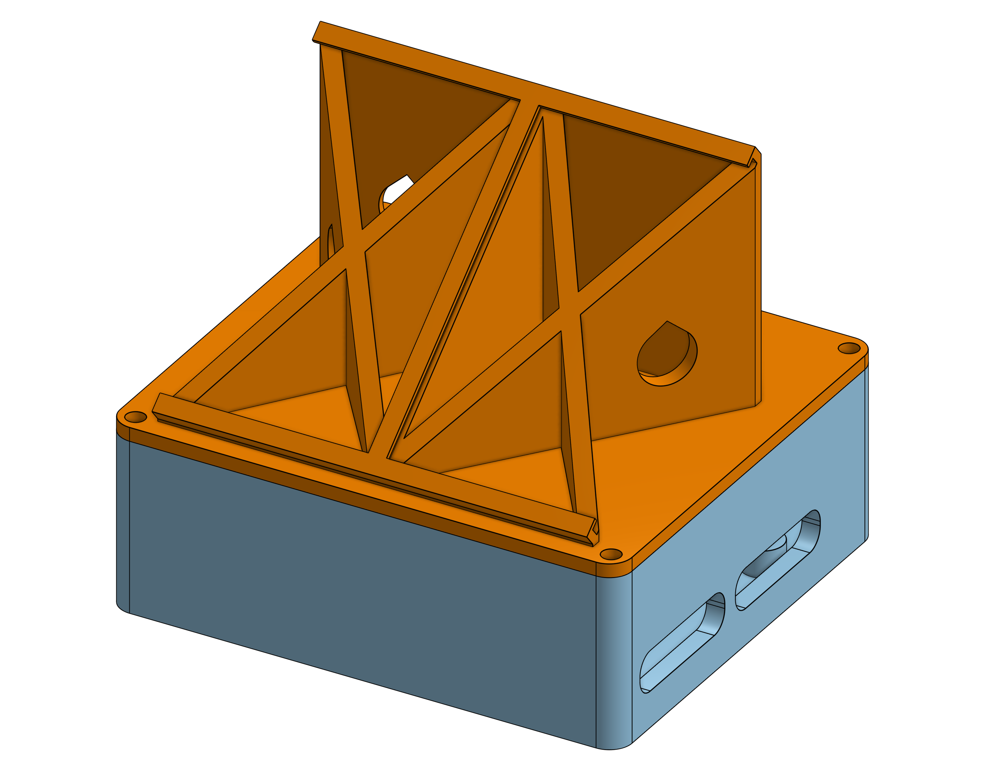
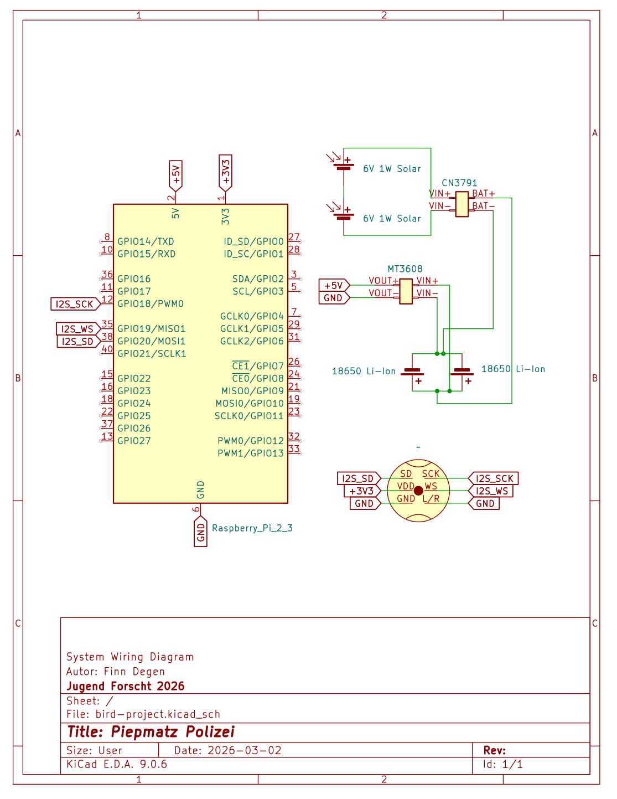
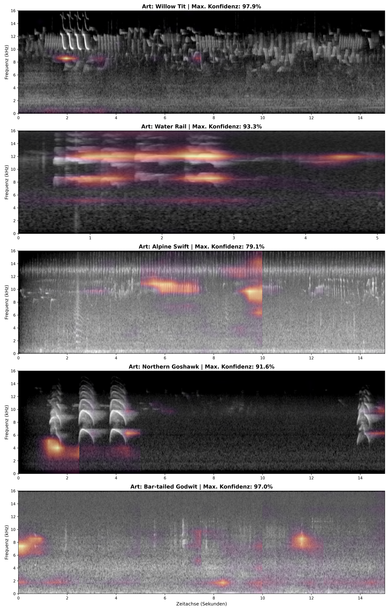
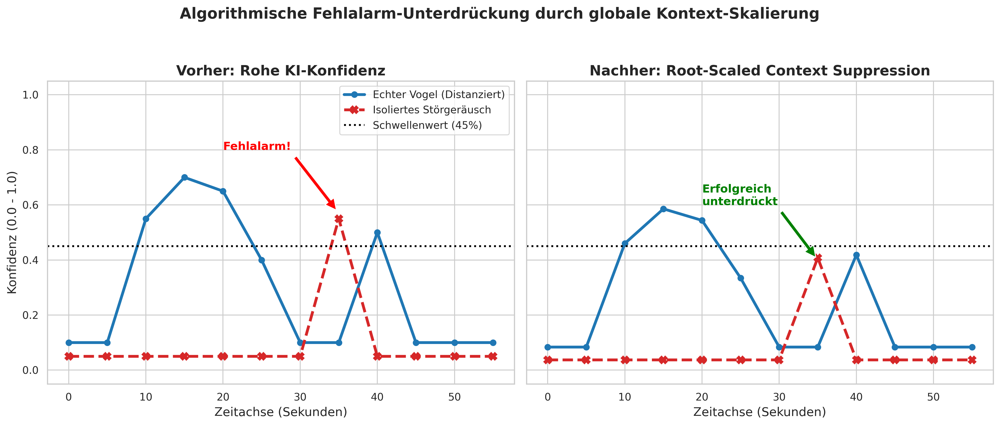

<div align="right">
  <a href="README.md">English</a> · <b>Deutsch</b>
</div>

<div align="center">

# Piepmatz Polizei

**Autarkes akustisches Monitoring europäischer Vogelarten**  
*Jugend forscht 2026 — Finn Degen & Jonathan Ledwon*

[](docs/main.pdf)
[](https://huggingface.co/BoredVoidAter/piepmatz-polizei)
[](#ml-pipeline--ergebnisse)

<br>


</div>

**Auszeichnungen (Jugend forscht 2026):**
* **Regionalwettbewerb Erlangen:** 1. Preis (Mathematik/Informatik, Dieter Schwarz Stiftung) & Sonderpreis Umwelttechnik (DBU)
* **Landeswettbewerb Bayern:** Sonderpreis „Biodiversität“ (Hermann Gutmann Stiftung) & Sonderpreis Naturgucker (NABU)

---

## Überblick

Piepmatz Polizei kombiniert einen solarbetriebenen **ESP32**-Sensorknoten, einen **Raspberry Pi 5**-Inferenzserver und **CNN-Klassifikatoren** auf Basis europäischer Xeno-Canto-Aufnahmen, um Vogelarten (sowie Gesang vs. Ruf) kontinuierlich im Freiland zu erfassen.

Die vollständige schriftliche Ausarbeitung zu Methodik, Experimenten und Hardware findet sich unter **[docs/main.pdf](docs/main.pdf)**.

---

## Systemarchitektur & Hardware

Um die Akkulaufzeit am Sensor im Feld zu maximieren und gleichzeitig volle Modellpräzision zu fahren, ist die Architektur auf zwei Knoten verteilt:

1. **Solarer Edge-Node (`hardware/esp32_mic/`):** Ein **ESP32-WROOM-32U** liest 32-kHz-Audio per I2S von einem **INMP441**-MEMS-Mikrofon ein und streamt 16-Bit-Mono-PCM über TCP (`Port 5000`). Die autarke Stromversorgung übernehmen zwei 6V-1W-Solarmodule, ein **CN3791**-MPPT-Laderegler, zwei **18650**-Li-Ion-Zellen und ein MT3608-Step-Up-Wandler in einem CAD-konstruierten Gehäuse.
2. **Basisstation (`hardware/pi_server/`):** Ein **Raspberry Pi 5** spannt einen lokalen WLAN-Hotspot auf und betreibt ein **FastAPI- + WebSocket-Dashboard** (`web_dashboard.py`) mit Bandpass-Filter (1–12 kHz), **Wake-on-Sound**-RMS-Vorfilterung, **ONNX Runtime**-Inferenz, Audio-Replay-Archiv, CSV-Export und Open-Meteo-Wetterdaten.

| Prototyp im Gehäuse | CAD-Konstruktion (Onshape) | Schaltplan (KiCad) |
| :---: | :---: | :---: |
|  |  |  |

---

## ML-Pipeline & Ergebnisse

Audioaufnahmen werden in 5-Sekunden-Fenster zerlegt, in 128-Band-Mel-Spektrogramme (`224×224`) umgewandelt und mit **SpecAugment**, **MixUp** sowie klassengewichtetem Sampling (`WeightedRandomSampler`) trainiert. Störgeräusch-Klassen (Insekten, Amphibien, Säugetiere) werden bei der Inferenz herausgefiltert.

### Modellvergleich (Europa-Datensatz)

| Architektur | Test-Accuracy | Einordnung |
| :--- | :---: | :--- |
| **EfficientNet-B0** (3-ch, FP32) | **96,7 %** | Höchste Genauigkeit; produktiv als `efficientnet_fp32.onnx` |
| **ResNet-18** (3-ch) | **94,6 %** | Starke Vergleichs-Baseline |
| **Custom CNN** (5 Schichten) | **61,5 %** | From-Scratch trainiert (`2` Schichten: 40,8 %, `3` Schichten + Attn: 60,6 %) |
| **Metric Learning** (ArcFace) | **60,0 %** | Embedding-Evaluation per Nearest-Centroid / k-NN |

> **Erkenntnisse zur Edge-Optimierung:** Eine nachträgliche INT8-Quantisierung verkleinerte das ONNX-Modell zwar von `19,1 MB` auf `5,2 MB`, führte durch die Squeeze-and-Excitation-Skalierung im EfficientNet jedoch zu starkem Genauigkeitsverlust. Ebenso verschlechterten Auflösungen unter `128 px` die Mel-Frequenztrennung (`94,0 %` → `75,6 %` bei MobileNetV3). Mit `224×224` FP32 plus **Wake-on-Sound**-RMS-Gating sparen wir im Tagesverlauf bis zu ~65 % Rechenlast bei voller Erkennungsrate.

### Signalstabilisierung & Erklärbarkeit

* **Temporale Glättung & Kontext-Unterdrückung:** Eine 1D-Faltung über benachbarte Zeitfenster (`[0.1, 0.2, 0.4, 0.2, 0.1]`) sowie unsere wurzelskalierte Kontext-Unterdrückung ($P(t, c) \cdot \sqrt{P_{\max}(c)}$) unterdrücken kurze Störgeräusche (Wind, Äste), ohne leise entfernte Vogelrufe zu verlieren.
* **Grad-CAM-Validierung:** Saliency-Heatmaps bestätigen, dass sich das Netz tatsächlich an artspezifischen Frequenzmustern orientiert.

| Grad-CAM Sliding Window | Fehlalarm-Unterdrückung |
| :---: | :---: |
|  |  |

---

## Schnellstart

### 1. Lokale Inferenz & Live-Mikrofon-Radar

```bash
git clone https://github.com/finn-degen-dev/bird-project.git
cd bird-project

# Mit NixOS-Flake (Python 3.12 + CUDA + LaTeX):
nix develop

# Oder klassisch mit pip:
pip install -r requirements.txt

# Vortrainierte Modelle von Hugging Face laden
python download_models.py

# Live-Radar starten (oder --file pfad/zur/audio.mp3)
python src/showcase.py --model efficientnet --live
```

### 2. Raspberry-Pi-Basisstation & Web-Dashboard

```bash
pip install -r hardware/pi_server/requirements.txt
python hardware/pi_server/web_dashboard.py
# Dashboard erreichbar unter http://localhost:8000 (ESP32-TCP-Stream auf Port 5000)
```

---

## Vortrainierte Modelle

Alle Checkpoints und Klassenlisten liegen auf Hugging Face ([`BoredVoidAter/piepmatz-polizei`](https://huggingface.co/BoredVoidAter/piepmatz-polizei)):

* `--model efficientnet` — **EfficientNet-B0** (höchste Genauigkeit für PC / Pi 5)
* `--model mobilenet` — **MobileNetV3-Small** (geringste Latenz für schwächere CPUs)
* `--model resnet` — **ResNet-18** (Baseline-Modell)
* `--model efficientnet-type` — **Gesang vs. Ruf**-Klassifikator

```bash
python download_models.py --list             # Alle verfügbaren Modelle anzeigen
python download_models.py --model mobilenet  # Einzelnes Modell herunterladen
```
